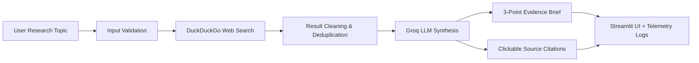

# Experiment 10: MLOps Deployment of a Task-Automation Agent

[](https://github.com/kbhrsiddhi1289/experiment-10-mlops-agent/actions/workflows/ci.yml)
[](https://www.python.org/downloads/)
[](https://www.docker.com/)
[](https://render.com/)
[](LICENSE)

An end-to-end MLOps pipeline and web application deploying an autonomous **Task-Automation Research Brief Agent**. The agent accepts any user research topic, executes a real-time web search via DuckDuckGo, cleans and deduplicates the search results, and prompts a high-performance **Groq Cloud LLM** (`llama-3.3-70b-versatile` by default) to synthesize an evidence-backed, **exactly three-bullet research brief** with clickable citations.

---

## 📌 Architecture & Workflow



1. **User Input:** Topic validated against null values, whitespace, and length boundaries ($\le 300$ characters).
2. **DuckDuckGo Web Search:** Queries live search results using the maintained `duckduckgo-search` library.
3. **Data Preprocessing:** Discards malformed links, non-HTTP schemes, empty bodies, and deduplicates identical URLs.
4. **Groq LLM Processing:** Formulates prompt enforcing strict adherence to retrieved context and strictly three concise bullet points.
5. **Observability & Telemetry:** Collects search latency, LLM latency, and request metrics via Python `logging` and in-memory process tracking.

---

## 🛠️ Technology Stack

- **Web Interface:** [Streamlit](https://streamlit.io/)
- **LLM Provider:** [Groq Cloud](https://console.groq.com/) (using the official `groq` Python SDK)
- **Default Model:** `llama-3.3-70b-versatile` (configurable via `GROQ_MODEL`)
- **Web Search:** `duckduckgo-search`
- **Testing:** `pytest` (with deterministic unit and pipeline mocks)
- **Containerization:** Docker (`python:3.11-slim`, non-root user `appuser`, UID 1000)
- **CI/CD:** GitHub Actions (Lint/Syntax, Pytest, Docker Build)
- **Hosting Target:** Hugging Face Spaces (Docker SDK)

---

## 🚀 Local Windows Setup

### 1. Prerequisites
- Windows 10/11 with PowerShell
- Python 3.11 installed
- Git installed
- A free Groq API key from [https://console.groq.com/keys](https://console.groq.com/keys)

### 2. Clone and Setup Environment
Open PowerShell inside the project directory:

```powershell
# Create Python virtual environment
python -m venv .venv

# Activate the virtual environment
.\.venv\Scripts\Activate.ps1

# Upgrade pip and install dependencies
.\.venv\Scripts\python.exe -m pip install --upgrade pip
.\.venv\Scripts\python.exe -m pip install -r requirements.txt
```

### 3. Configure Secrets Privately
Copy the `.env.example` template to `.env` (never commit `.env`):

```powershell
Copy-Item .env.example .env
```

Open `.env` in your editor and enter your Groq API key:
```ini
GROQ_API_KEY=gsk_your_actual_key_here
GROQ_MODEL=llama-3.3-70b-versatile
PORT=8501
```

> **Security Note:** You can also enter the Groq API key directly into the Streamlit sidebar at runtime. The key is never displayed in logs, terminal outputs, or Git commits.

### 4. Run the Streamlit Application
Using the virtual environment Python:
```powershell
.\.venv\Scripts\python.exe -m streamlit run app.py
```
Or using the provided PowerShell helper script:
```powershell
.\run.ps1 app
```
Visit **http://localhost:8501** in your browser.

---

## 🧪 Automated Testing

Automated unit tests use comprehensive mocks for search and LLM calls, ensuring 100% deterministic, offline, and zero-cost execution.

Run the test suite:
```powershell
.\.venv\Scripts\python.exe -m pytest
```
Or with the runner:
```powershell
.\run.ps1 test
```

### Test Coverage Summary:
- Topic validation (empty, too short, excessive length)
- Search result sanitization, filtering, and URL deduplication
- Parsing and boundary validation of exactly 3 bullet points
- Missing API key error handling
- Network and LLM outage resilience
- Configuration loading and safe credential masking

---

## 🐳 Docker Containerization

### 1. Build the Docker Image
```powershell
docker build -t experiment-10-agent:local .
```

### 2. Run the Container with Runtime Secret Injection
Pass your credentials securely at runtime using the local `.env` file:
```powershell
docker run --rm -p 8501:8501 --env-file .env experiment-10-agent:local
```
Or provide the environment variable directly on the command line:
```powershell
docker run --rm -p 8501:8501 -e GROQ_API_KEY="gsk_..." experiment-10-agent:local
```
Access the application at `http://localhost:8501`.

---

## 🔄 GitHub Actions CI/CD Pipeline

The `.github/workflows/ci.yml` pipeline triggers automatically on all pushes and pull requests to `main`. It executes:
1. **Repository Checkout:** Clones code securely.
2. **Python Environment Setup:** Configures Python 3.11 with pip caching.
3. **Dependency Installation:** Installs requirements.
4. **Syntax Compilation:** Compiles code with `py_compile`.
5. **Automated Unit Testing:** Executes all `pytest` suites.
6. **Docker Build Verification:** Builds the container image without requiring API keys.

---

## 🚀 Render Cloud Deployment

Deploying on [Render](https://render.com/) is fast and free.

### Option A: Using Render Blueprints (Automatic)
1. Sign in to [Render Dashboard](https://dashboard.render.com/).
2. Click **New +** &rarr; **Blueprint**.
3. Connect your GitHub repository: `https://github.com/kbhrsiddhi1289/experiment-10-mlops-agent`.
4. Render detects `render.yaml` automatically.
5. In the environment variables prompt, enter your `GROQ_API_KEY`.
6. Click **Apply**. Render builds and deploys your Streamlit app with a public `onrender.com` URL.

### Option B: Manual Web Service Setup
1. Click **New +** &rarr; **Web Service**.
2. Connect `https://github.com/kbhrsiddhi1289/experiment-10-mlops-agent`.
3. Configure:
   - **Environment:** `Python 3` (or `Docker`)
   - **Build Command:** `pip install -r requirements.txt`
   - **Start Command:** `streamlit run app.py --server.port $PORT --server.address 0.0.0.0 --server.headless true --browser.gatherUsageStats false`
4. Under **Environment Variables**:
   - `GROQ_API_KEY` = your Groq API key
   - `GROQ_MODEL` = `qwen/qwen3.8-27b`
5. Click **Deploy Web Service**.

---

## ☁️ Hugging Face Spaces Deployment

The repository is configured for Hugging Face Spaces using the **Docker SDK**.

### Step-by-Step Deployment:
1. Sign in to your [Hugging Face](https://huggingface.co/) account.
2. Click **New Space** &rarr; give it a name (e.g., `experiment-10-mlops-agent`).
3. Select **Space SDK: Docker** &rarr; Blank template &rarr; Public/Private.
4. In your Space's **Settings** &rarr; **Variables and secrets**:
   - Add Secret: `GROQ_API_KEY` = your Groq API key.
   - Add Variable (optional): `GROQ_MODEL` = `llama-3.3-70b-versatile`.
5. Push this repository to the Hugging Face Space git remote:
   ```bash
   git remote add space https://huggingface.co/spaces/<your-username>/<your-space-name>
   git push space main:main
   ```
6. The Space will build the Docker container and expose the application on port 7860.

---

## 📊 Telemetry and Monitoring

- **Structured Logging:** All search durations, LLM latency, and request events are logged with timestamps using Python's `logging` module.
- **In-Memory Telemetry:** The sidebar displays session-level total requests, successes, failures, and average latencies.
- **Zero Secrets Logged:** Sensitive credentials and headers are scrubbed and masked (`gsk_...xyz`).

---

## 📄 License
This project is open-source under the MIT License.
