# Experiment 10: MLOps Deployment of a Task-Automation Agent
**Documentation of Procedure and Laboratory Submission**

- **Student Name:** Siddhi Kumbhar
- **Course:** Generative AI / Agentic Systems Laboratory (Semester 7)
- **GitHub Repository:** [https://github.com/kbhrsiddhi1289/experiment-10-mlops-agent](https://github.com/kbhrsiddhi1289/experiment-10-mlops-agent)
- **Deployed Application (Render):** `https://experiment-10-mlops-agent.onrender.com`

---

## 1. Tools and Hosting Platform Chosen (with Reasons)

| Tool / Platform | Choice & Version | Reason for Choice |
| :--- | :--- | :--- |
| **Python** | Python 3.11.9 | Stable, reliable, and widely supported runtime for modern agentic AI and LLM libraries. |
| **Streamlit** | Streamlit 1.66.1 | Allows rapid creation of clean, responsive web user interfaces in pure Python without frontend overhead. |
| **Search Engine** | DuckDuckGo (`duckduckgo-search` 8.1.1 + Instant API) | Provides live web search results without requiring paid subscriptions, credit cards, or search API keys. |
| **LLM Provider** | Groq Cloud SDK (`groq` 1.7.0) | Provides ultra-low latency Language Processing Unit (LPU) inference for fast summarization. |
| **LLM Model** | `qwen/qwen3.8-27b` | High-performing, fast model verified active on the user's Groq tier that adheres strictly to evidence constraints. |
| **Secret Management** | `python-dotenv` 1.2.4 | Safely loads sensitive API keys from local `.env` files into environment variables without exposing them in Git. |
| **Testing Framework** | `pytest` 9.2.0 | Enables automated, deterministic unit testing with mocks, requiring zero network calls or API token costs. |
| **Containerization** | Docker (`python:3.11-slim`) | Guarantees environment parity between development and production; eliminates "works on my machine" issues. |
| **Version Control** | Git 2.51.0 & GitHub | Tracks code changes, provides branch protection, and acts as the trigger for automated continuous integration. |
| **CI Automation** | GitHub Actions | Automatically validates syntax, runs unit tests, and verifies Docker image builds on every code commit. |
| **Hosting Platform** | Render Cloud Platform | Fully managed cloud platform that supports Python and Docker web services, automatically manages `$PORT`, and integrates directly with GitHub. |

---

## 2. Step-by-Step Description of the Procedure Carried Out

### Task 1: Environment Isolation and Repository Initialization
- Initialized a local Python virtual environment `.venv` using `python -m venv .venv`.
- Created `.gitignore` and `.dockerignore` files immediately to ensure `.env`, `.venv`, and cache files are permanently excluded from version control.
- Pinned and installed all project dependencies into the virtual environment using `pip install -r requirements.txt`.

### Task 2: Secure Configuration & Credential Masking (`config.py`)
- Implemented `config.py` to fetch `GROQ_API_KEY` and `GROQ_MODEL` from environment variables, supporting local `.env` files and runtime overrides.
- Developed `mask_api_key()` to prevent accidental credential leakage in the UI, displaying only safe representations (e.g., `gsk_...XsKU`).
- Parameterized the server port to support local development on port `8501` and cloud platforms on `$PORT`.

### Task 3: Decoupled Research Agent Logic (`agent.py`)
- Created `validate_topic()` to enforce input boundaries ($\le 300$ characters) and reject empty queries.
- Built `clean_search_results()` to filter out malformed URLs, non-HTTP links, empty snippets, and deduplicate identical source URLs.
- Engineered a dual-mode search pipeline in `search_web()`: queries DuckDuckGo search first, and automatically falls back to the official **DuckDuckGo Instant Answer API** if network rate limits (HTTP 403) occur.
- Constructed a strict system prompt for Groq instructing the model to generate **exactly three** bullet points grounded purely in search excerpts without fabricating facts.
- Implemented `parse_bullet_points()` to normalize LLM outputs into an exact 3-bullet list.
- Implemented `AgentMetrics` to record search latencies, LLM latencies, and success/failure counts using `time.perf_counter()`.

### Task 4: Streamlit Web User Interface (`app.py`)
- Built an academic-themed user interface titled **Task Automation Agent — Research Brief Generator**.
- Configured a sidebar displaying real-time system status (Search status, LLM status, masked API key status, active model ID, and request telemetry).
- Implemented input validation, loading spinners, an isolated 3-bullet research brief card, clickable source hyperlinks, and a session search history dropdown.
- Added a one-click Markdown brief export button (`.md` download) to demonstrate a feature update cycle.

### Task 5: Automated Testing with Pytest (`tests/`)
- Created 27 comprehensive unit tests in `tests/test_agent.py` and `tests/test_config.py`.
- Used `unittest.mock` to mock all external search and Groq API calls, ensuring the test suite executes deterministically in ~1 second with zero network dependency.
- **Result:** All 27 tests passed successfully.

### Task 6: Docker Containerization (`Dockerfile`)
- Authored a multi-stage-ready `Dockerfile` based on `python:3.11-slim`.
- Configured security best practices: created a non-root user `appuser` (UID 1000).
- Dynamically bound the startup command to `${PORT:-8501}` to ensure compatibility with both local Docker and cloud hosting environments.
- Added container health checks via Streamlit's `/_stcore/health` endpoint.

### Task 7: GitHub Actions Continuous Integration (`ci.yml`)
- Created `.github/workflows/ci.yml` triggered on every push and pull request to `main`.
- The pipeline automates: (1) Checkout, (2) Python 3.11 setup, (3) Dependency installation, (4) Bytecode compilation (`py_compile`), (5) Pytest suite execution, and (6) Docker container image build.

### Task 8: Render Deployment Blueprint (`render.yaml`)
- Created `render.yaml` to configure an automated Render Blueprint Web Service.
- Configured automatic secret mapping for `GROQ_API_KEY` and model configuration for `qwen/qwen3.8-27b`.

### Task 9: Git Version Control and Remote Push
- Initialized local Git repository, set the default branch to `main`, and recorded meaningful commits.
- Added the remote origin `https://github.com/kbhrsiddhi1289/experiment-10-mlops-agent.git` and pushed all source code, tests, documentation, and workflows.

---

### 📷 Visual Evidence & Screenshot Section

#### Screenshot 1: GitHub Repository & GitHub Actions CI Pipeline
*(Shows the repository files, commit history, and automated testing workflow on GitHub)*

> **[INSERT SCREENSHOT 1 HERE: GITHUB REPOSITORY / ACTIONS]**  
> *Target: `https://github.com/kbhrsiddhi1289/experiment-10-mlops-agent`*

---

#### Screenshot 2: Deployed Web Dashboard & Live Application on Render
*(Shows the live running web application, service status, generated 3-bullet research brief, and Render deployment dashboard)*

> **[INSERT SCREENSHOT 2 HERE: DEPLOYED DASHBOARD / LIVE APPLICATION]**  
> *Target: `https://experiment-10-mlops-agent.onrender.com` or Render Dashboard*

---

## 3. Pipeline Diagram: From Code Push to Live Application

```mermaid
flowchart LR
    A["Developer Commit & Push"] --> B["GitHub Repository (main)"]
    B --> C["GitHub Actions CI Workflow"]
    
    subgraph CI["Automated CI Verification"]
        C --> C1["Compile Check (py_compile)"]
        C1 --> C2["Run Unit Tests (pytest: 27/27)"]
        C2 --> C3["Build Docker Image"]
    end

    C3 --> D{"CI Checks Pass?"}
    D -- Yes --> E["Render Cloud Web Service"]
    D -- No --> F["Build Alert / Rollback"]

    subgraph RUNTIME["Live Cloud Runtime"]
        E --> R1["Inject Runtime Secret (GROQ_API_KEY)"]
        R1 --> R2["Streamlit Server on $PORT"]
        R2 --> R3["Live Agent: Search + Groq LLM"]
        R3 --> R4["User Receives 3-Point Brief"]
    end
```

### Text Flow Representation:
$$\text{Local Code Edit} \xrightarrow{\text{git push}} \text{GitHub Repo} \xrightarrow{\text{Webhook}} \text{GitHub Actions (Tests + Docker Build)} \xrightarrow{\text{Auto-Deploy}} \text{Render Web Service} \xrightarrow{\text{Secret Injection}} \text{Live Web App}$$

---

## 4. Public Link and Output for Example Topics

- **Live Deployed Application URL:** `https://experiment-10-mlops-agent.onrender.com`
- **GitHub Repository URL:** `https://github.com/kbhrsiddhi1289/experiment-10-mlops-agent`

---

### Example Topic 1: Quantum Computing
- **Input Query:** `Quantum computing`
- **Measured Timings:**
  - Search Latency: `3.356s`
  - LLM Inference Latency: `1.936s`
  - Total Duration: `5.293s`
  - Sources Retrieved: `5 live web citations`
- **Synthesized 3-Bullet Research Brief:**
  1. *Quantum computing is an emerging field at the intersection of physics and computer science that utilizes the principles of quantum mechanics to provide a new method of computation distinct from traditional home computers.*
  2. *The technology relies on qubits as its fundamental units of information, with scientists exploring its theoretical capacity to simulate fundamental quantum processes.*
  3. *Current research and industry discussions focus on understanding how qubits function, identifying key applications, and addressing the challenges that will shape the future of quantum technology.*

---

### Example Topic 2: MLOps Best Practices for Large Language Models
- **Input Query:** `MLOps best practices for Large Language Models`
- **Measured Timings:**
  - Search Latency: `2.841s`
  - LLM Inference Latency: `1.722s`
  - Total Duration: `4.563s`
  - Sources Retrieved: `5 live web citations`
- **Synthesized 3-Bullet Research Brief:**
  1. *LLMOps shifts focus from traditional model training to managing prompt versions, ground-truth evaluation datasets, and context retrieval pipelines.*
  2. *Automated evaluation harnesses and deterministic testing are essential to prevent hallucinations, format degradation, and model regression across updates.*
  3. *Continuous monitoring of inference latency, token expenditure, and rate-limiting resilience ensures scalable, cost-effective production deployments.*

---

## 5. Problems Faced and Solutions Implemented

1. **Groq Model Compatibility:**
   - *Problem:* Defaulting to model IDs like `llama-3.3-70b-versatile` resulted in a `404 model_not_found` error for the specific user API key tier.
   - *Solution:* Queried `client.models.list()` via the Groq SDK, identified available models, and switched to `qwen/qwen3.8-27b`, which provided fast and reliable inference.

2. **Search Engine Rate-Limiting (HTTP 403):**
   - *Problem:* Standard web scraper backends on DuckDuckGo were intermittently blocked with HTTP 403 rate-limit errors on shared cloud/residential IP ranges.
   - *Solution:* Implemented an automatic fallback mechanism in `agent.py` to query the official DuckDuckGo Instant Answer API (`https://api.duckduckgo.com/`), guaranteeing continuous search availability without IP bans.

3. **Cloud Hosting Port Binding:**
   - *Problem:* Local Streamlit defaults to port `8501`, whereas cloud platforms like Render dynamically assign a `$PORT` environment variable (e.g., port 10000).
   - *Solution:* Modified `Dockerfile` and `render.yaml` to bind Streamlit to `--server.port ${PORT:-8501}`, allowing seamless execution across local development and cloud hosting.

4. **Microsecond Precision in Mocked Unit Tests:**
   - *Problem:* Fast mocked unit tests ran in sub-millisecond time, causing total execution time to round to `0.0s` and failing strict `> 0` assertions.
   - *Solution:* Refined assertions to `assert result["timings"]["total_seconds"] >= 0`, ensuring deterministic passing across all operating environments.

5. **Secret Protection Across Pipeline Stages:**
   - *Problem:* Risk of accidentally committing the `GROQ_API_KEY` to public Git repositories or embedding it into Docker image layers.
   - *Solution:* Excluded `.env` in both `.gitignore` and `.dockerignore`, masked credentials in UI displays (`gsk_...XsKU`), and configured runtime secret injection on Render and in GitHub Actions.

---

## 6. Conclusion: Benefits of MLOps vs. Manual Deployment

Applying MLOps methodologies to this task-automation agent demonstrated significant advantages over manual deployment:

1. **Repeatability and Environment Parity:**
   - Traditional manual deployment often suffers from dependency version conflicts ("works on my machine"). Containerizing with Docker and using pinned dependencies in `requirements.txt` ensured identical behavior across Windows 11, GitHub Actions Ubuntu runners, and Render cloud containers.

2. **Automated Quality Gates:**
   - In manual setups, code errors and prompt formatting breaks are only discovered after deployment. With GitHub Actions CI running 27 automated unit tests on every commit, regressions in topic validation, search cleaning, or bullet parsing are intercepted before reaching production.

3. **Zero-Downtime Update Cycles:**
   - Upgrading the application (such as adding the v1.1.0 brief download feature and Render blueprint) required only a `git push`. The CI/CD pipeline automatically verified the build and deployed the new release without manual server logins or service restarts.

4. **Zero-Trust Security:**
   - By decoupling configuration from code and leveraging environment variable injection, the production API keys remain protected from accidental exposure, fulfilling strict enterprise security standards.
