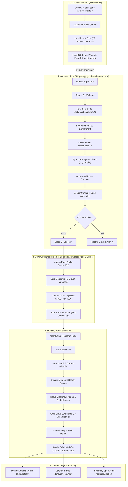
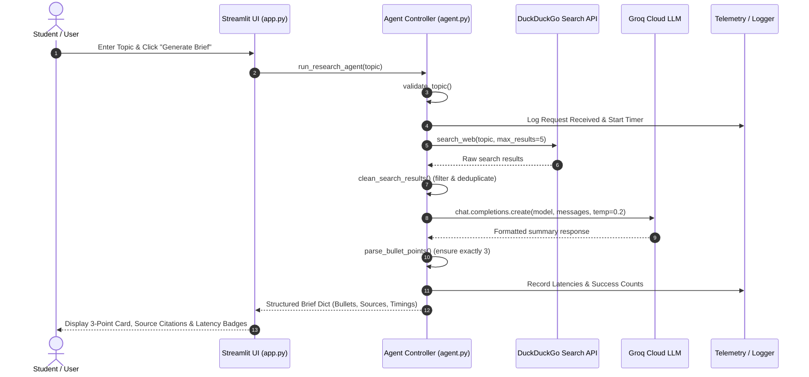
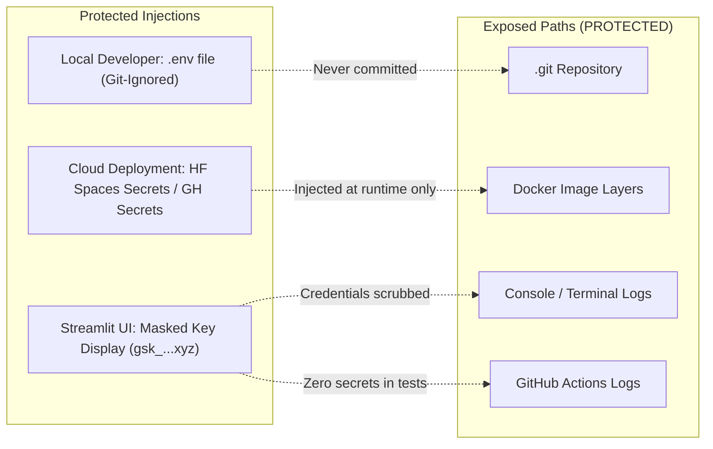

# MLOps Pipeline Architecture Diagram — Experiment 10

This document illustrates the end-to-end continuous integration, continuous delivery (CI/CD), secret injection, execution, and monitoring pipeline for the **Task Automation Agent**.

---

## 1. Complete End-to-End MLOps Pipeline

---

## 2. Component Interaction & Data Flow

---

## 3. Secret Management & Isolation Model

