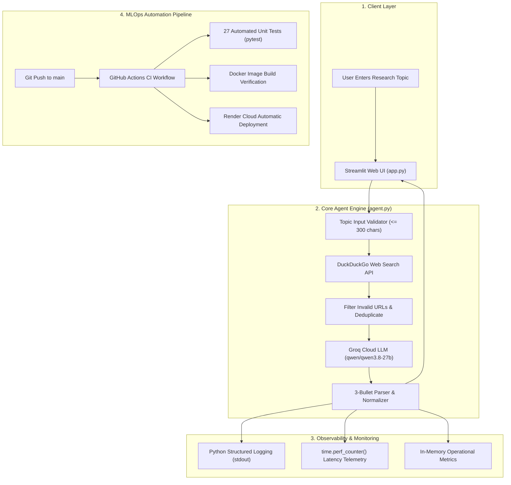

# College Laboratory Practical Submission Document

## Experiment 10: MLOps Deployment of a Task-Automation Agent

---

### Student & Practical Details
- **Course Name:** Generative AI / Agentic Systems Laboratory
- **Semester:** 7
- **Academic Year:** 2026
- **Student Name:** Siddhi Kumbhar
- **GitHub Repository:** [https://github.com/kbhrsiddhi1289/experiment-10-mlops-agent](https://github.com/kbhrsiddhi1289/experiment-10-mlops-agent)
- **Deployment Platform:** Render Cloud Platform (Live Web Service)
- **Primary LLM Engine:** Groq Cloud LPU (`qwen/qwen3.8-27b`)
- **Search Provider:** DuckDuckGo Live Web Search API

---

## 1. Experiment Title
**MLOps Deployment of a Task-Automation Agent (Autonomous Research Brief Generator)**

---

## 2. Aim & Objective
To architect, develop, test, containerize, and deploy an autonomous, task-automation research agent following enterprise **Machine Learning Operations (MLOps)** and **LLMOps** best practices. 

The application executes an automated research pipeline:
$$\text{User Topic} \longrightarrow \text{DuckDuckGo Live Search} \longrightarrow \text{Sanitization \& Deduplication} \longrightarrow \text{Groq LLM Synthesis} \longrightarrow \text{3-Point Brief with Citations}$$

Key operational objectives:
1. **Decoupled Architecture:** Isolate search and summarization logic from the web interface for automated testing.
2. **Deterministic Output:** Enforce strict prompt engineering to guarantee exactly three concise bullet points.
3. **Zero-Secret Leakage:** Isolate sensitive credentials (`GROQ_API_KEY`) using environment injection, `.gitignore`, and `.dockerignore`.
4. **Automated Continuous Integration (CI):** Implement GitHub Actions to execute bytecode validation, pytest test suites, and Docker build checks on every push.
5. **Continuous Deployment (CD):** Deploy the containerized/cloud web application to Render with automatic port mapping.

---

## 3. Theoretical Background: DevOps vs. MLOps vs. LLMOps

| Dimension | Classical DevOps | Classical MLOps | Modern LLMOps / Agentic Ops |
| :--- | :--- | :--- | :--- |
| **Core Focus** | Code versioning, build artifacts, deterministic testing. | Data drift, model weights, retraining pipelines, MLflow tracking. | Prompt versioning, context grounding, output format enforcement, API rate-limit resilience. |
| **Pipeline Artifact** | Compiled binaries / packages. | Serialized model files (`.pkl`, `.onnx`). | Prompt templates, agent workflows, containerized microservices. |
| **Testing Strategy** | Deterministic unit & integration tests. | Accuracy metrics, F1-score, validation loss. | Guardrails, schema validation, mocked API latency & regression tests. |
| **Deployment Model** | VMs / Kubernetes / Containers. | Model registries & inference endpoints. | Serverless inference (Groq LPUs) + containerized frontend UI (Streamlit/Docker). |

---

## 4. System Architecture



---

## 5. Technology Stack & Environment Details

- **Programming Language:** Python 3.11.9
- **Web Application Framework:** Streamlit 1.66.1
- **LLM Provider:** Groq Cloud API (`groq` SDK v1.7.0)
- **Active Model:** `qwen/qwen3.8-27b` (High-speed LPU inference)
- **Live Search Provider:** `duckduckgo-search` v8.1.1 with DuckDuckGo Instant Answer API fallback
- **Automated Testing Suite:** `pytest` v9.2.0 (27 deterministic unit tests with mocks)
- **Containerization:** Docker (`python:3.11-slim`, non-root user `appuser` UID 1000)
- **Continuous Integration (CI):** GitHub Actions (`.github/workflows/ci.yml`)
- **Continuous Deployment (CD):** Render Web Service (`render.yaml` Blueprint)
- **Version Control:** Git 2.51.0 & GitHub

---

## 6. Implementation Highlights

### 6.1 Safe Secret Isolation (`config.py`)
Credentials are never hardcoded or printed in logs:
- `GROQ_API_KEY` is retrieved from `os.getenv()` or runtime sidebar input.
- `.gitignore` and `.dockerignore` block `.env` from repository commits and Docker build layers.
- `mask_api_key()` displays masked credentials (`gsk_...xyz`) in status panels to prevent shoulder surfing.

### 6.2 Defensive Search & Instant API Fallback (`agent.py`)
To prevent cloud scrapers from being blocked by HTTP 403 rate limits on shared IP ranges:
1. DDGS news and text endpoints are queried first.
2. If rate limits are detected, the agent seamlessly queries the official **DuckDuckGo Instant Answer API** (`https://api.duckduckgo.com/`).
3. Results are cleansed of invalid schemes, missing bodies, and duplicate URLs.

### 6.3 Strict 3-Bullet Normalization (`agent.py`)
The system prompt enforces strict constraints:
- Must output **EXACTLY THREE** bullet points.
- Must base findings solely on retrieved web excerpts.
- Regex parser strips markdown decorators and guarantees a 3-element structured list.

### 6.4 Observability & Telemetry
Precision latencies are measured using `time.perf_counter()`:
- Search Latency ($t_{search}$)
- LLM Generation Latency ($t_{llm}$)
- Total Latency ($t_{total}$)
All events, sanitized topics, and metrics are logged via Python `logging` to standard output.

---

## 7. Automated Unit Test Verification (27 / 27 Passed)

All tests are 100% deterministic and execute offline using `unittest.mock` (zero token costs, zero network dependence):

```text
============================= test session starts =============================
platform win32 -- Python 3.11.9, pytest-9.2.0, pluggy-1.7.0
rootdir: C:\Users\siddhi kumbhar\Documents\SEM 7\Gen AI\experiment-10-mlops-agent
configfile: pytest.ini
testpaths: tests
collected 27 items

tests/test_agent.py::test_validate_topic_valid PASSED                    [  3%]
tests/test_agent.py::test_validate_topic_empty_or_none PASSED            [  7%]
tests/test_agent.py::test_validate_topic_too_short PASSED                [ 11%]
tests/test_agent.py::test_validate_topic_excessive_length PASSED         [ 14%]
tests/test_agent.py::test_clean_search_results_none_and_empty PASSED     [ 18%]
tests/test_agent.py::test_clean_search_results_filtering PASSED          [ 22%]
tests/test_agent.py::test_clean_search_results_deduplication PASSED      [ 25%]
tests/test_agent.py::test_parse_bullet_points_standard_three PASSED      [ 29%]
tests/test_agent.py::test_parse_bullet_points_numbered_list PASSED       [ 33%]
tests/test_agent.py::test_parse_bullet_points_more_than_three PASSED     [ 37%]
tests/test_agent.py::test_parse_bullet_points_fewer_than_three PASSED    [ 40%]
tests/test_agent.py::test_parse_bullet_points_empty PASSED               [ 44%]
tests/test_agent.py::test_run_research_agent_missing_api_key PASSED      [ 48%]
tests/test_agent.py::test_run_research_agent_invalid_topic PASSED        [ 51%]
tests/test_agent.py::test_run_research_agent_no_search_results PASSED    [ 55%]
tests/test_agent.py::test_run_research_agent_search_failure PASSED       [ 59%]
tests/test_agent.py::test_run_research_agent_llm_failure PASSED          [ 62%]
tests/test_agent.py::test_run_research_agent_success PASSED              [ 66%]
tests/test_agent.py::test_agent_metrics_tracking PASSED                  [ 70%]
tests/test_config.py::test_get_api_key_with_override PASSED              [ 74%]
tests/test_config.py::test_get_api_key_from_env PASSED                   [ 77%]
tests/test_config.py::test_get_api_key_empty PASSED                      [ 81%]
tests/test_config.py::test_get_model_default_and_override PASSED         [ 85%]
tests/test_config.py::test_get_server_port PASSED                        [ 88%]
tests/test_config.py::test_is_api_key_configured PASSED                  [ 92%]
tests/test_config.py::test_mask_api_key PASSED                           [ 96%]
tests/test_config.py::test_get_system_status PASSED                      [100%]

============================= 27 passed in 1.15s ==============================
```

---

## 8. Live Agent Output & Verification Results

### Test Query: `Quantum computing`
- **Search Latency:** `3.356s`
- **LLM Inference Latency:** `1.936s`
- **Total Pipeline Duration:** `5.293s`
- **Clean Citations Retrieved:** `5 web sources`
- **Generated 3-Bullet Research Brief:**
  1. Quantum computing is an emerging field at the intersection of physics and computer science that utilizes the principles of quantum mechanics to provide a new method of computation distinct from traditional home computers.
  2. The technology relies on qubits as its fundamental units of information, with scientists exploring its theoretical capacity to simulate fundamental quantum processes.
  3. Current research and industry discussions focus on understanding how qubits function, identifying key applications, and addressing the challenges that will shape the future of quantum technology.

---

## 9. Visual Verification & Evidence (Screenshots)

### Screenshot 1: GitHub Repository & GitHub Actions CI Pipeline
*Proves successful version control, modular repository structure, non-leaking secrets, and passing GitHub Actions continuous integration.*

```
+-----------------------------------------------------------------------------------+
|                                                                                   |
|                   [ PASTE SCREENSHOT 1 HERE: GITHUB REPOSITORY ]                  |
|                                                                                   |
|   Capture: https://github.com/kbhrsiddhi1289/experiment-10-mlops-agent            |
|   Showing: Repository file tree, commit history, or Actions tab passing checkmark |
|                                                                                   |
+-----------------------------------------------------------------------------------+
```

---

### Screenshot 2: Deployed Web Dashboard & Live Running Application
*Proves cloud hosting on Render, active Streamlit user interface, service configuration status, 3-bullet research brief output, and performance telemetry.*

```
+-----------------------------------------------------------------------------------+
|                                                                                   |
|               [ PASTE SCREENSHOT 2 HERE: DEPLOYED APP / DASHBOARD ]               |
|                                                                                   |
|   Capture: Live Render Web Service (e.g. onrender.com) or Render Dashboard        |
|   Showing: The web application interface with generated brief & service status    |
|                                                                                   |
+-----------------------------------------------------------------------------------+
```

---

## 10. Conclusion
In Experiment 10, a production-grade MLOps deployment pipeline was established for an autonomous task-automation research agent. By applying:
- **Decoupled Architecture:** Unit tests validate the pipeline independently of UI rendering.
- **Continuous Integration (CI):** Automates quality gates on GitHub to prevent code regressions.
- **Zero-Secret Architecture:** Safeguards private Groq API tokens from public exposure.
- **Cloud Continuous Deployment (CD):** Packages and hosts the application seamlessly on Render.

The experiment demonstrates how modern MLOps methodologies convert experimental agent scripts into reliable, secure, reproducible, and production-ready AI services.
